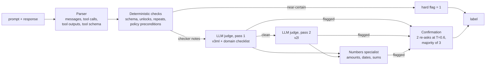

# Guardian of Truth: a contextual-hallucination detector for LLM agents

Solution for the **AIJ Contest 2026 "Guardian of Truth"** task: given one turn of an LLM customer-service agent
(airline, retail, telecom, banking; τ²-bench trajectories translated into Russian), decide whether the turn
contains a **contextual hallucination**. That means a value that contradicts the context, a non-existent tool or
entity, a violated policy rule, or a claim, reason or result that the context does not support.

The detector is a black box over text. It reads only the context the agent saw (`prompt`) and the turn under
review (`response`), and outputs `0/1`. It runs offline on one A100 80 GB within 30 minutes for ~550 rows, using
one open model (**Qwen3.6-35B-A3B-FP8**) served by vLLM.



## How it works

1. **Parser** (`src/guardian/parse.py`) splits the `⟦…⟧` transcript into user/agent messages, tool calls and
   multi-line tool outputs. It also parses the `[AVAILABLE TOOLS]` schema, including nested and required fields.
2. **Deterministic checks** (`features.py`, `policy.py`, `rules2.py`) cover: a tool missing from the schema, a
   discoverable tool called without being unlocked, missing required arguments, an exact repeat of a failed
   call, placeholder arguments, unmet policy preconditions (per domain), a return *and* an exchange on one
   order, a false refusal or premature transfer when a tool could do the job, and more. Near-certain findings
   are **hard flags**. All findings are also passed to the LLM as "checker notes".
3. **LLM judge** (`judge.py`). Qwen3.6 in thinking mode runs with a general checklist (`judge_prompt_v3ml.md`)
   plus a domain checklist (`judge_domain_*.md`), and must quote the source lines behind its verdict. Long
   contexts are compressed: the policy, the schema and the recent dialogue are kept, plus the older tool-output
   lines that contain values the turn states. Generation stops at the first `VERDICT`, and the probability
   is read from the logprob of the verdict digit. A second prompt (`judge_prompt_v2l.md`) re-reads the rows
   the first pass left clean.
4. **Numbers specialist** (`spec_numbers.md`) re-checks turns that contain amounts, dates or arithmetic.
5. **Confirmation** (`scripts/predict.py: confirm_stage`) re-asks every LLM flag twice at temperature 0.6 and
   keeps it only by a majority of 3. This removes most of the judge's run-to-run noise.
6. **Combination** (`combine.py`, `model/calibration.json`): a row is labelled 1 if it has a hard flag or a
   confirmed judge flag. A global deadline guarantees the time limit: rows the judge has not finished get a
   deterministic fallback score, and a valid output file is written as soon as the run starts.

The full story is in **[docs/SOLUTION.md](docs/SOLUTION.md)**: what the labels count, how we evaluated, the
numbers, and the long list of ideas that did *not* work.

## Results

| | F1 |
|---|---|
| Organisers' baseline (same model, one token, no reasoning), public leaderboard | 0.490 |
| Our best scored submission (sub11), public leaderboard | **0.612** |
| This version (s11o), organisers' `valid.parquet` (46 rows) | 0.978 |
| This version, 576 natural rows of an external GLM-labelled public-like set | 0.771 (sub11-like version: 0.60) |

The external set is [KarimovDev/guardian-of-truth-dataset-2026](https://github.com/KarimovDev/guardian-of-truth-dataset-2026).
Our versions scored about the same on its natural rows as on the public leaderboard, so it was the most useful proxy we had.
The s11o fixes were partly found on the same rows, so treat 0.771 as optimistic.

End to end on the platform stack (vLLM 0.19.1, 543 private-like rows, including model loading) the run takes ~14 min, against a 30-min limit.

## Repository layout

```
src/guardian/        detector package: parser, deterministic checks, judge client, vLLM launcher, prompts (*.md)
scripts/predict.py   entry point used by the evaluation platform
model/               calibration.json (pipeline config); put the model weights here
tools/               build the submission archive; pre-send check without a GPU
tests/               format-robustness test (no GPU needed)
experiments/         research scripts (evaluation, ablations, LoRA/GSPO, K2 port); see experiments/README.md
docs/SOLUTION.md     detailed write-up
```

## Running it

Requirements: a GPU with ≥ 80 GB (A100/H100) and vLLM (tested with **0.19.1**, the platform's version, and 0.31).
`pip install .` installs only the light dependencies. vLLM and torch are expected in the environment.

```bash
pip install .
# weights: the official FP8 checkpoint (the organisers' baseline ships the same model)
huggingface-cli download Qwen/Qwen3.6-35B-A3B-FP8 --local-dir model/
# optional, saves ~2 GB: drop the vision tower and the MTP head
python experiments/strip_weights.py model/ model_stripped/ model.visual,mtp

python scripts/predict.py --input test.parquet --output pred.parquet          # starts vLLM on ./model
python scripts/predict.py --input test.parquet --output pred.parquet \
       --base-url http://127.0.0.1:8090/v1 --served-name judge                # use a running server
python scripts/predict.py --input test.parquet --output pred.parquet --no-llm # deterministic checks only, CPU
```

Input: a CSV or parquet file with `id, prompt, response`. Output: `id, label`, in the format chosen by the
`--output` extension. `--budget-sec` (default 26 min) bounds the total runtime.

Build the platform archive (stored zip, under 40 GB) and check it without a GPU:

```bash
MODEL_SRC=/path/to/Qwen3.6-35B-A3B-FP8 bash tools/build_submission.sh   # -> dist/guardian_submission.zip
VALID=/path/to/valid.parquet bash tools/precheck.sh dist/submission
python -m pytest tests
```

The competition data is not included. Get it from the competition page.

## License

The code is under MIT (see [LICENSE](LICENSE)). `experiments/k2port/k2_horizon_*.py` are adapted from vLLM
(Apache-2.0) and keep their original headers. The model weights are under their own license
(Qwen3.6: Apache-2.0).
